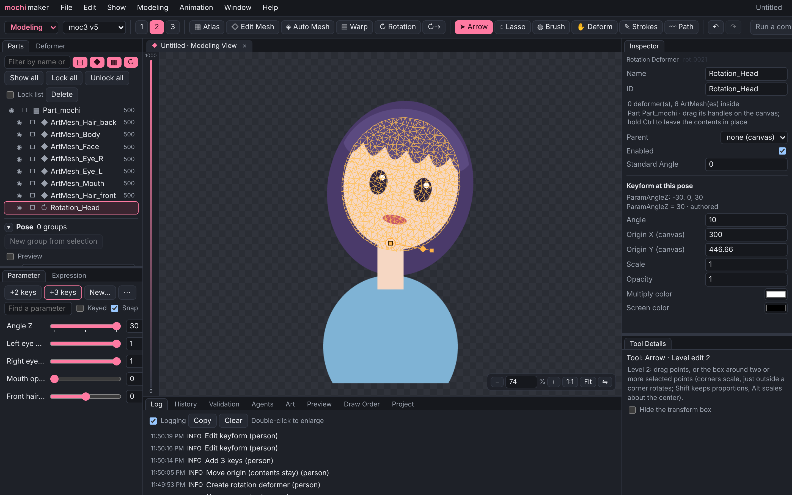
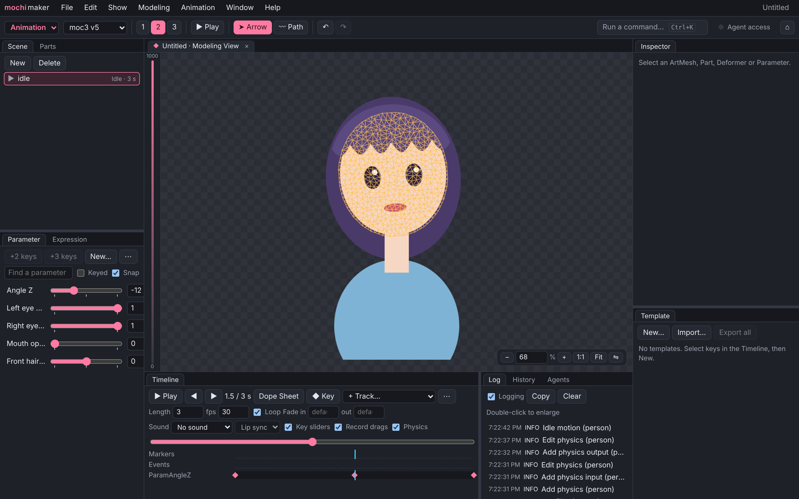
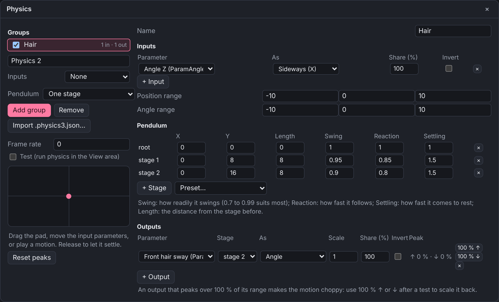

# Mochi Maker

An open-source, agent-first editor for creating and rigging models for Live2D
Cubism-compatible apps, built on the Mochi2D runtime. MIT licensed.


*Modeling: a rotation deformer turns the head; the Inspector shows its keyform at this pose.*


*Animation: an idle motion in the Timeline, played on the model with its physics.*


*Physics: the front hair swings after the head.*

The model in these pictures is «Mochi», the getting-started guide's example. It is in
[`samples/mochi/`](samples/mochi/) as a model folder to try in any app that reads these files.

**Status:** a working editor, agent API and exporter, not yet at a 1.0 release. These work:

- the document model, commands, transactions, undo and redo, the replayable log and the project
  format; PSD, OpenRaster and PNG-folder import; automatic mesh generation, mesh editing, brushes
  and stroke meshing;
- deformers: nested warps and rotations, reparenting that keeps things in place, and canvas-space
  editing through Mochi2D's forward mapping;
- export of `.moc3` (versions 3–5, with `--moc-version auto`), textures and the runtime files
  through Mochi2D, with clipping masks, multiply and screen colors, hit areas, display info, user
  data, physics, expressions, pose, motions, sounds and motion sync;
- the agent API and the MCP server, with headless renders, sweeps and visual diffs;
- the editor: a web app over the same commands, with Mochi2D's view, a familiar layout (menu bar,
  toolbar, View area tabs and dockable palettes per workspace), rebindable shortcuts, a command
  bar, the timeline with the Dope Sheet and the Graph Editor, model templates, the usual parameter
  IDs, image and video export, and `window.mochi` for agents;
- the live bridge: agents work in the open editor through `mochi-maker bridge` (Mochi Studio's
  bridge protocol), with pairing, tokens with scopes, a control lease and `mochi-maker mcp
  --bridge`;
- the desktop app: the editor in Electron, with project folders saved straight to disk, auto-saved
  copies with recovery, the live link on a file watcher and the bridge built in; unsigned builds
  for Windows, macOS and Linux;
- the conformance pack (`conformance/`): every golden project exported at versions 3–5, with
  scenarios, results and reference renders, for checks by other implementations;
- a command-line tool.

Glue and blend-shape authoring are not available in this build. Their code and tests are in the
repository behind the feature flags `glue` and `blendShapes`, which are off by default
([`docs/core.md`](docs/core.md#feature-flags)). Projects that hold glue or blend shapes still open,
but they do not export while the flags are off. Version 6 (offscreens and blend modes) and `.moc3`
import are not started.

See [`docs/roadmap.md`](docs/roadmap.md) for each milestone.

## Quick start

A model to try: [`samples/mochi/`](samples/mochi/) is the getting-started guide's model, exported
by Mochi Maker (MIT licensed, like the rest of the repository).

Requires Node 20 or later.

```sh
npm ci
npm run build
npx mochi-maker new demo.mochi --canvas 2048x4096
npx mochi-maker import demo.mochi character.psd --preview import.png   # layers, parts, meshes
npx mochi-maker export demo.mochi --out out/demo                       # a model folder for the runtime
npx mochi-maker describe                       # every command, with a summary
npx mochi-maker describe rig.addBinding        # schema, errors and examples
npx mochi-maker run demo.mochi commands.jsonl  # one transaction from a command file
npx mochi-maker query demo.mochi artMesh
npx mochi-maker validate demo.mochi
```

A command file holds one `{"name": ..., "args": ...}` per line. Arguments that
name objects take a UID (`mesh_0004`), an export ID (`@mesh:ArtMesh_Face`), a
display name (`@mesh~"Left eye"`), or `$n` for the result of command n in the
same file:

```jsonl
{"name":"param.create","args":{"exportId":"ParamAngleX","min":-30,"max":30,"keys":[-30,0,30]}}
{"name":"part.create","args":{"exportId":"PartHead","name":"Head"}}
{"name":"mesh.create","args":{"part":"$1","uv":[[0,0],[100,0],[100,100]],"triangles":[[0,1,2]]}}
{"name":"rig.addBinding","args":{"target":"$2","parameter":"$0"}}
```

From TypeScript:

```ts
import { Session } from '@mochi-maker/core';

const s = Session.create({ width: 2048, height: 4096 });
s.transact('Rig the eye', (tx) => {
  const eye = tx.run('param.create', { exportId: 'ParamEyeLOpen', min: 0, max: 1, default: 1 });
  const mesh = tx.run('mesh.create', { exportId: 'ArtMesh_EyeL', uv: [[0, 0], [40, 0], [40, 20]], triangles: [[0, 1, 2]] });
  tx.run('rig.addBinding', { target: mesh.uid, parameter: eye.uid });
  tx.run('keyform.set', { target: '@mesh:ArtMesh_EyeL', cell: { [eye.uid]: 0 }, values: { opacity: 0 } });
});
s.undo(); // one step: the whole transaction
```

The editor:

```sh
npm run editor        # then open the printed URL, and drop a project folder or zip on it
npx mochi-maker bridge   # let agents in: pair the editor in Agent access, give the agent a token
```

The desktop app (`docs/desktop.md`):

```sh
npm run build && npm run build:editor
npm run start -w @mochi-maker/desktop           # or package:linux for an unsigned Linux build
```

## Documentation

- [`docs/guide/`](docs/guide/README.md): **getting started**, from a layered PSD to a model that
  moves in Mochi2D, by hand in the editor or by an agent
- [`docs/core.md`](docs/core.md): the core and the CLI as they are built today
- [`docs/art.md`](docs/art.md): art import, mesh generation and mesh editing
- [`docs/export.md`](docs/export.md): export, golden projects and fuzzing
- [`docs/agent-api.md`](docs/agent-api.md): the typed API and the MCP server (`mochi-maker mcp`)
- [`docs/editor.md`](docs/editor.md): the editor and `window.mochi`
- [`docs/desktop.md`](docs/desktop.md): the desktop app, its files, auto-saves, bridge and security
- [`docs/bridge.md`](docs/bridge.md): the live bridge, tokens, the control lease and `mcp --bridge`
- [`docs/design.md`](docs/design.md): the design
- [`docs/agent-api-design.md`](docs/agent-api-design.md): the agent interface
- [`docs/roadmap.md`](docs/roadmap.md): milestones
- [`CONTRIBUTING.md`](CONTRIBUTING.md): building, testing and the sign-off for contributions
- [`SECURITY.md`](SECURITY.md): reporting vulnerabilities, and what the app opens to the network
  and the file system
- [`ASSETS.md`](ASSETS.md): where the repository's images, models and sounds come from

## Development

```sh
npm run build       # TypeScript project build
npm test            # Vitest: unit, law and property tests
npm run check       # typecheck (sources and tests), tests and formatting
```

Packages live in `packages/`:

- `geometry`: Mochi Maker's own algorithms, with no dependencies;
- `core`: headless, with no Node or DOM dependencies outside
  `@mochi-maker/core/node`;
- `art`: import formats and image-based operations;
- `export`: lowering to Mochi2D's model data, the atlas and the runtime files;
- `api`: the typed agent API over a project;
- `bridge`: the live bridge (protocol, server and client);
- `mcp`: the MCP server;
- `cli`;
- `editor`: the web app (Vite);
- `desktop`: the desktop app (Electron).

Mochi2D is pinned as `vendor/mochi2d-0.21.0.tgz`. Third-party packages are
listed in [`THIRD_PARTY_NOTICES.md`](THIRD_PARTY_NOTICES.md).

**How it was made.** Most of this code was written by AI coding agents (Anthropic's Claude) under the direction of the project's maintainer, through the clean-room process in [CLEANROOM.md](CLEANROOM.md). Copyright may not subsist in every part of it. To the extent it does, it is licensed under the MIT License. Either way, it is provided as is, without warranty. Third-party code keeps its own licenses ([THIRD_PARTY_NOTICES.md](THIRD_PARTY_NOTICES.md)).

## Models and their terms

Mochi Maker ships no model but its own sample (`samples/mochi/`, made by this project's code). `assets/models/` is ignored by git and is
meant for models you supply locally; never commit model data. When Mochi Maker
can import existing models (a planned feature), remember that editing or
redistributing someone else's model is subject to that model's terms of use.

## Patents

This project is licensed under the MIT License, which grants no patent rights. Reading some model files uses techniques, such as joining meshes ("glue") and blend shapes, that may be covered by third-party patents in some countries, including Japan and the United States. The project has taken no legal opinion on this, and makes no statement that any patent is or is not infringed. If you use or distribute it in such a country, above all commercially, check for yourself whether you need a license.

---

Live2D and Live2D Cubism are trademarks or registered trademarks of Live2D Inc. VTube Studio is a product of DenchiSoft. Mochi Maker is an independent project. It is not affiliated with, endorsed by, sponsored by or supported by either, and it contains none of their code or files.
