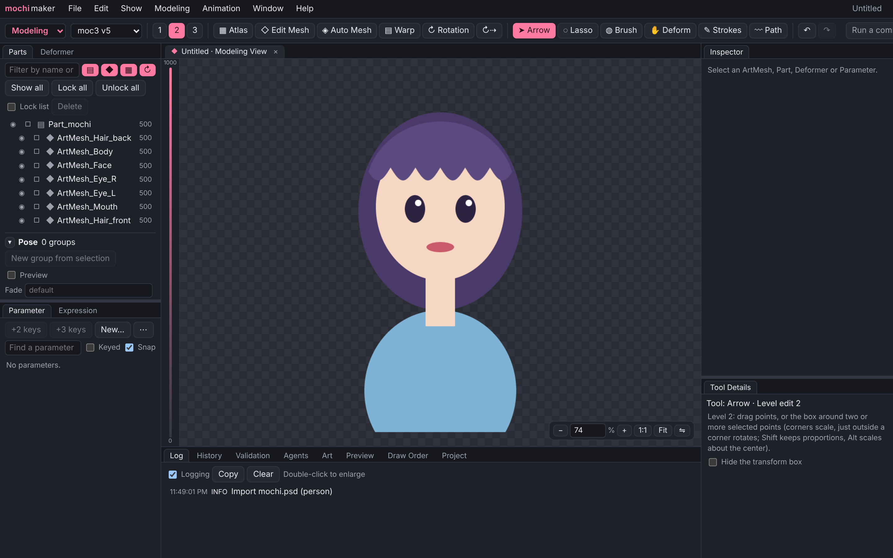
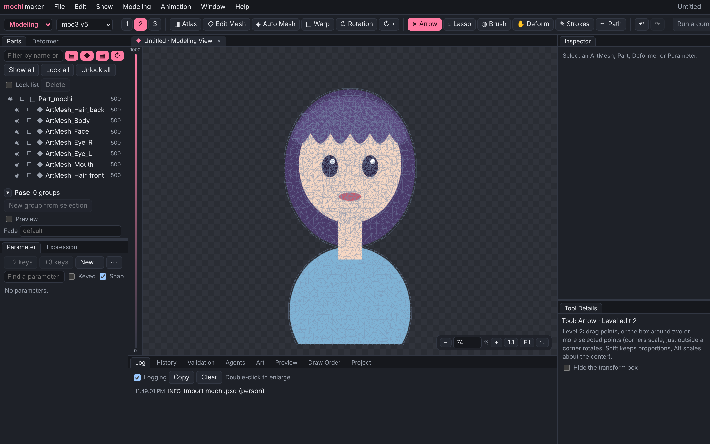
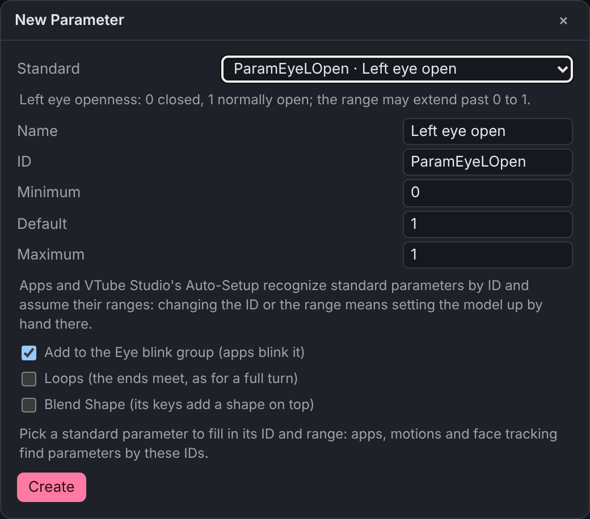
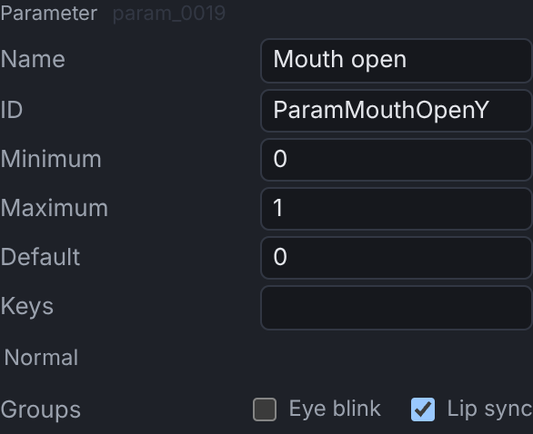
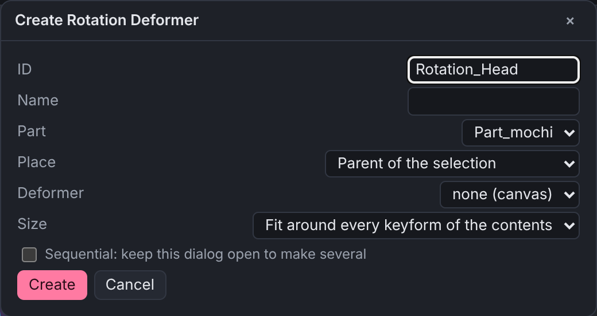
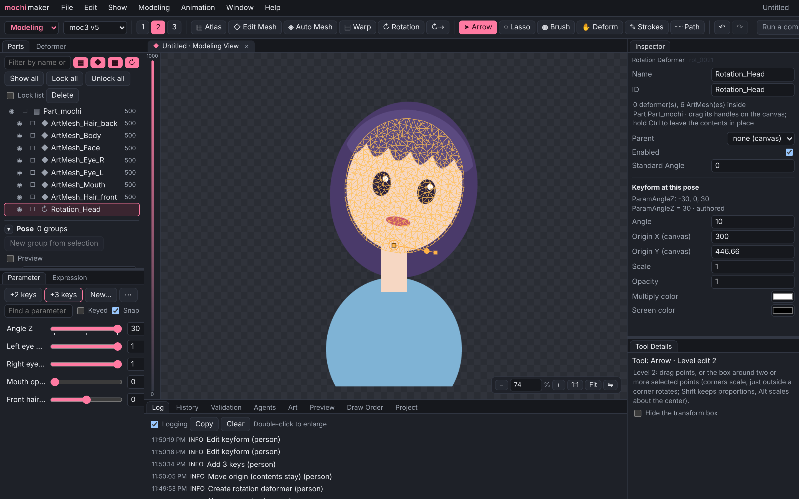
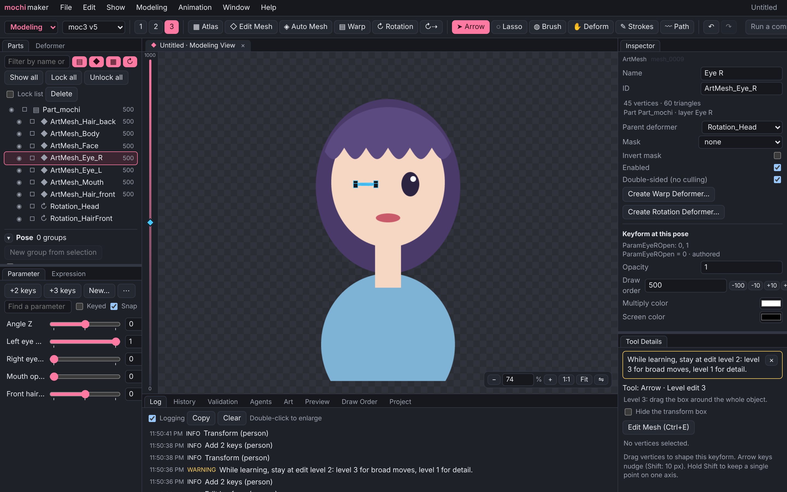
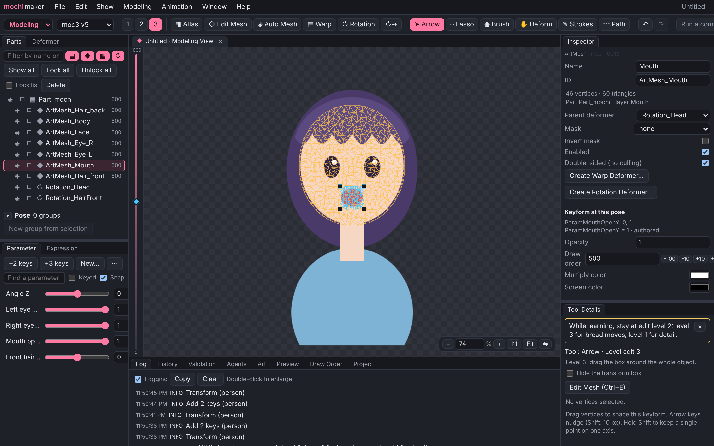
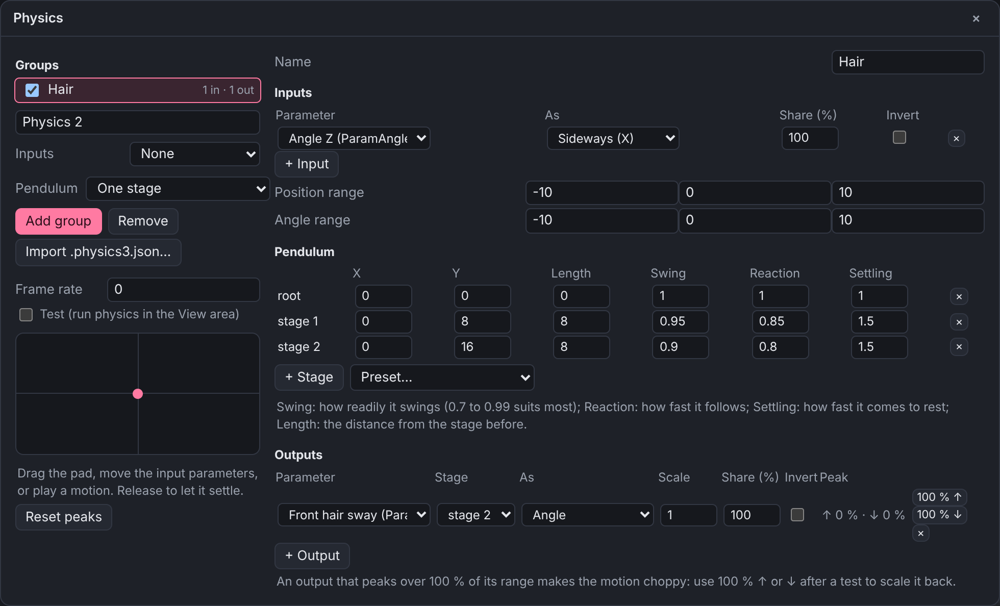

# Getting started: from a layered PSD to a moving model

This guide takes you from a layered PSD to a model that loads and moves in any app built on
Mochi2D. You import the art, check its meshes, add five parameters, and give the eyes and mouth to
the standard groups. Then you build two rotation deformers, key the eyes and mouth, add physics to
the hair, and export. It takes about twenty minutes.

There are two paths:

- **By hand in the editor:** this page.
- **By an agent through the MCP server:** [agent.md](agent.md), the same model in a few tool calls.

Both paths are tested step by step: `packages/editor/test/guide.test.ts` follows this page in the
editor, and `packages/mcp/test/guide.test.ts` follows the agent's. The screenshots come from the
first test.

## What you need

- **Mochi Maker**, either:
  - the editor in a browser: `npm ci && npm run build && npm run editor`, then open the printed
    address; or
  - the desktop app ([desktop.md](../desktop.md)).
- **A layered PSD.** Use [`mochi.psd`](mochi.psd), a 600 × 800 character drawn for this guide. It
  has seven layers: Hair back, Body, Face, Eye R, Eye L, Mouth, Hair front. With your own art, keep
  each part that moves on its own layer: each eye, the mouth, the front hair.

## 1. Import the art

Choose **File › Import Art** and pick `mochi.psd`, or drop the file on the window.

- Each layer becomes an **ArtMesh**: a textured mesh named after its layer (`ArtMesh_Eye_L` for
  «Eye L»). The Parts palette on the left lists them.
- A PSD's layer groups become **parts**. This PSD has no groups, so its layers go into one part
  named after the file, «mochi», which you can fold, hide or lock as a whole.
- Each ArtMesh gets an automatic mesh around its pixels.

## 2. Look at the meshes

**Show › Every ArtMesh's Wireframe** shows the triangles. The automatic meshes are fine for this
character. For your own art you can change them later:

- **Edit Mesh** (Ctrl+E) to move, add or remove points by hand;
- **Auto Mesh** to make them again with other settings.

Turn the wireframes off again with the same menu item.

## 3. Add the parameters

A **parameter** is a slider that apps move: the head's tilt, an eye's openness. Click **New…** on
the Parameter palette for each one, and pick it from **Standard**: the list fills in its ID, name
and range.

| Standard | ID | Minimum | Default | Maximum |
|---|---|---|---|---|
| Head › Angle Z | `ParamAngleZ` | −30 | 0 | 30 |
| Eyes › Left eye open | `ParamEyeLOpen` | 0 | 1 | 1 |
| Eyes › Right eye open | `ParamEyeROpen` | 0 | 1 | 1 |
| Mouth and cheeks › Mouth open | `ParamMouthOpenY` | 0 | 0 | 1 |
| Hair › Front hair sway | `ParamHairFront` | −1 | 0 | 1 |

Keep these IDs and ranges: apps, motions and face tracking look for parameters by ID, and VTube
Studio's Auto-Setup also assumes the standard ranges. The dialog says so when a range is changed,
and warns about an ID that differs from a standard one only by letter case.

## 4. The standard groups

Apps blink a model's **Eye blink** parameters by themselves, and move its **Lip sync** parameters
with a voice. New Parameter already offered them: **Add to the Eye blink group** for the eyes, and
**Add to the Lip sync group** for the mouth, checked. To see or change them later:

1. Click a parameter's name, with nothing else selected, to show it in the Inspector.
2. **Eye blink** is checked for `ParamEyeLOpen` and `ParamEyeROpen`.
3. **Lip sync** is checked for `ParamMouthOpenY`.

## 5. A rotation deformer for the head

A **deformer** moves the meshes inside it. A **rotation deformer** turns them around a pivot.

1. Select the head's meshes in the Parts palette with Ctrl+click: Face, Eye R, Eye L, Mouth, Hair
   front, Hair back.
2. Choose **Rotation** on the toolbar (Modeling › Create Rotation Deformer…).
3. Type the ID `Rotation_Head`, and click **Create**.

**The pivot.** The new deformer is selected, and its handle shows on the canvas. Ctrl+drag its
pivot (the square) down to the neck. Ctrl leaves the meshes where they are.

**The tilt.**

1. With `Rotation_Head` selected, click `Angle Z` on the Parameter palette, then **+3 keys**. The
   deformer now has a **keyform** at −30, 0 and 30: its shape at each of those values.
2. Move the Angle Z slider to −30 and type **Angle** −10 in the Inspector's «Keyform at this pose».
3. Move it to 30 and type 10.

The values in between are blended: drag the slider and the head tilts.

## 6. A rotation deformer for the front hair

1. Select **ArtMesh_Hair_front** and create a rotation deformer, `Rotation_HairFront`. It goes
   inside `Rotation_Head`, so the hair follows the head.
2. Ctrl+drag its pivot to the top of the head.
3. Give it three keys on `Hair Front`, with Angle −8 at −1 and 8 at 1.

## 7. The eyes

For each eye (`ArtMesh_Eye_L` with `ParamEyeLOpen`, `ArtMesh_Eye_R` with `ParamEyeROpen`):

1. Select the eye, click its parameter, and click **+2 keys** (0 and 1).
2. Move the slider to 0: the eye is shut there.
3. Switch to edit level **3** (the toolbar, or the 3 key). A box appears around the whole eye.
4. Hold **Alt** (scale about the center) and drag the box's top corner down until the eye is a
   thin line.
5. Go back to level **2**, and set the slider back to 1.

## 8. The mouth

1. Select `ArtMesh_Mouth`, click `Mouth Open`, and click **+2 keys**.
2. At 1, use level 3 and Alt-drag the box's bottom corner down to open the mouth.

## 9. Physics for the hair

**Modeling › Physics…** opens the physics dialog, beside the canvas.

1. Name a new group **Hair**, pick the pendulum **Two stages**, and click **Add group**.
2. Under **Inputs**, click **+ Input** and pick `Angle Z (ParamAngleZ)`. The head's tilt pushes the
   pendulum.
3. Under **Outputs**, click **+ Output** and pick `Front hair sway (ParamHairFront)`. The pendulum's swing
   moves the hair.
4. Check **Test** and drag the pad, or move the Angle Z slider, to see the hair swing.

## 10. Export

**File › Export as MOC3 File** (Ctrl+Alt+S) writes the model:

- in the browser, a zip;
- in the desktop app, a folder you choose.

The files are:

- `model.moc3`, the model;
- `model.model3.json`, the settings that name everything else (with the Eye blink and Lip sync
  groups);
- `model.physics3.json`, the physics;
- `model.cdi3.json`, the display names;
- the texture.

Before writing, Mochi Maker loads the files back in Mochi2D and refuses an export that does not load.
Any app built on Mochi2D can now open `model.model3.json`. The model blinks and tilts, and its hair
swings after the head. The editor's View area already draws the model through Mochi2D, so the
sliders show what apps will show.

Save the project with **File › Save** (Ctrl+S), so you can come back to it.

## Next steps

- **A warp deformer** (Toolbar › Warp) bends a mesh with a grid; it is the usual way to turn a
  face left and right with `ParamAngleX`.
- **Motions:** the Animation workspace keys parameters over time. See [editor.md](../editor.md).
- **Expressions**, **motion sync** for a voice, and **model templates** are in
  [editor.md](../editor.md) as well.
- **Agents** can do all of this through the MCP server: [agent.md](agent.md).
